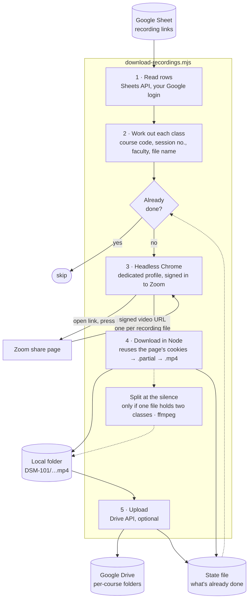

# Zoom recordings sync

Saves class Zoom recordings before their share links expire.

It reads a Google Sheet of recording links and opens each one in a headless
Chrome. It then downloads the video and files it by course, session and
faculty, optionally uploading it to Google Drive. It works even when the Zoom
page has no Download button.

```
recordings/
  DSM-101/DSM-101-1_2026-08-17_Suman-Majumdar.mp4
  DSM-107/DSM-107-2_2026-08-17_Karthikeya-Naraparaju.mp4
```

## Features

- **Safe to re-run.** Progress is saved per recording, so a run only does
  what's still pending.
- **Course codes.** Short sheet names (`ME (2)`) map to course codes
  (`DSM-107-2`), and session numbers are counted from the classes actually
  held, not copied from the sheet.
- **Several classes on one link.** It handles separate Zoom files on one link,
  and splits a single continuous recording at the silence between classes.
- **Drive upload (optional).** Files are uploaded into per-course folders, and
  local copies can be deleted once Drive has them.
- **Hand corrections in config.** Wrong faculty or swapped classes are fixed in
  config, and files already on Drive are renamed to match.
- **Scheduled runs on macOS (optional),** with an emailed report and a
  same-day retry.

## How the download works



1. **Read the sheet.** Rows are read with the Google Sheets API. No browser is
   needed for this.
2. **Plan each class.** Each row becomes one or more classes, each with its
   final file name. Classes the state file marks as done are skipped, and a
   run with nothing new never opens a browser.
3. **Get the video link.** A headless Chrome, with its own profile that's
   signed in to Zoom, opens the share link and presses Play. It then reads the
   signed video URL the player loads. That's why no Download button is needed.
4. **Download.** Node downloads that URL with the page's cookies into a
   `.partial` file and renames it when it's complete. If one recording holds
   two classes, ffmpeg splits it at the silence between them.
5. **Upload (optional).** The file goes to your Drive folder. Each step is
   recorded in the state file, so a re-run carries on where the last one
   stopped.

More detail is in [docs/how-it-works.md](docs/how-it-works.md).

## Quick start

```bash
npm install
cp config.local.example.json config.local.json   # add your sheet ID
npm run sync:dry                                 # first run: Google sign-in
npm run login                                    # first run: Zoom sign-in
npm run sync
```

You also need a Google OAuth client saved as `oauth-client.json`.
**[docs/SETUP.md](docs/SETUP.md)** walks through everything step by step.

## Commands

| Command | What it does |
|---|---|
| `npm run sync` | Download (and upload) everything pending |
| `npm run sync:dry` | Show what would happen; changes nothing |
| `npm run login` | Visible Chrome window to sign in to Zoom; fetches one recording |
| `node download-recordings.mjs --limit N` | Process at most N recordings |
| `node download-recordings.mjs --config other.json` | Use another config, for example next term |
| `node confirm-split.mjs <stateKey> --at MM:SS` | Split a two-class recording by hand |
| `node auth-personal-drive.mjs` | Store videos in a different Google account than the one reading the sheet |

## Project layout

```
download-recordings.mjs   main script: sheet → Zoom → disk → Drive
confirm-split.mjs         manual split for a two-class recording
auth-personal-drive.mjs   optional sign-in for a separate storage account
send-report.mjs           emails a run report (scheduled runs)
lib/                      config merge, splitting, session ledger, email
config.json               shared settings (no secrets)
config.local.json         your sheet/folder IDs and email (git-ignored)
*.sh                      optional macOS scheduling, see docs/daily-automation.md
docs/                     setup guide and design notes
```

## Documentation

- [Setup guide](docs/SETUP.md): get it running by hand.
- [How it works](docs/how-it-works.md): the pipeline, naming, multi-class
  links, corrections and state tracking.
- [Scheduled runs on macOS](docs/daily-automation.md): launchd, the report
  email, retries and waking the Mac.
- [Splitting continuous recordings](docs/continuous-recording-splitting.md)
- [Report email via the Gmail API](docs/email-notifications.md)
- [Background jobs on macOS](docs/background-automation.md)
- [Privacy policy](PRIVACY.md)

## Notes

- **Your own access only.** It downloads recordings you can already watch with
  your own login. Respect your institute's rules on redistributing them.
- **Keep secrets out of git.** Never commit `oauth-client*.json` or
  `config.local.json` (both are git-ignored).
